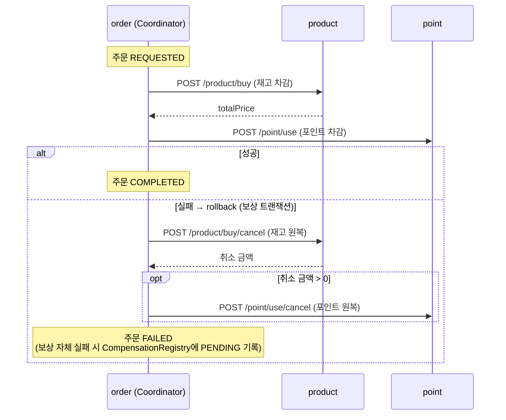

# 주문 시스템으로 알아보는 분산 트랜잭션 — SAGA Orchestration

주문·재고·포인트를 처리하는 주문 시스템을 order·product·point 서비스로 나누고,
이 브랜치(`saga-orchestration`)에서는 **SAGA 패턴의 Orchestration 방식**으로 분산 트랜잭션을 구현·테스트한다.

- 프로젝트 목적·요구사항·기술 스펙·모듈 구조·실행 방법, 구현 상세(API, 멱등성·동시성, 재시도)는 [프로젝트 설명](docs/project.md)에 정리했다.
- TCC·SAGA Orchestration·SAGA Choreography 세 패턴의 최종 비교는 [`saga-choreography`](../../tree/saga-choreography) 브랜치에 있고, TCC 구현은 [`tcc`](../../tree/tcc) 브랜치에 있다.

## SAGA란

- 각 작업을 **개별 로컬 트랜잭션**으로 나누어 처리하고, 실패하면 이미 완료한 작업을 **보상 트랜잭션(compensating transaction)** 으로 되돌려 정합성을 맞춘다.
- 리소스를 예약하지 않고 **즉시 차감**한다. 각 서비스의 DB 트랜잭션은 바로 커밋되므로, 보상이 끝나기 전까지는 일시적으로 불일치가 보일 수 있고 최종적으로 일관성을 맞춘다(**eventual consistency**).

### Orchestration 방식

- **코디네이터(오케스트레이터)** 가 각 참여자를 순차적으로 호출하면서 전체 트랜잭션의 흐름을 제어하고, 실패 시 보상을 지시한다.
- 흐름이 코디네이터 한 곳에 모여 있어 **흐름 파악이 쉽다**는 장점이 있어 **실무에서 많이 사용**된다.

## 이 브랜치의 Orchestration 구현

order 서비스의 `OrderCoordinator`가 오케스트레이터로서 product(재고)·point(포인트) 서비스를 동기 HTTP(RestClient)로 순서대로 호출하고, 실패하면 보상 트랜잭션을 지시한다.
API·락·재시도 등 구현 상세는 [SAGA Orchestration 구현 상세](docs/project.md#saga-orchestration-구현-상세)를 참고한다.

### 주문 처리 흐름 (`POST /order/place`)

```
OrderController
 └ Redis 락 order:orchestration:{orderId} 획득 (실패 시 예외) ── finally 락 해제
    └ OrderCoordinator.placeOrder
       ├ 주문 CREATED → REQUESTED
       ├ 1) product 재고 차감   (/product/buy)  → 응답 totalPrice
       ├ 2) point 포인트 차감   (/point/use, 금액 = totalPrice)
       ├ 주문 → COMPLETED
       └ 실패 시 rollback() 후 예외 전달
           ├ product 재고 차감 취소 (/product/buy/cancel)
           ├ 취소 금액(totalPrice) > 0 이면 point 포인트 차감 취소 (/point/use/cancel)
           ├ 주문 REQUESTED → FAILED
           └ 보상 자체가 실패하면 CompensationRegistry(PENDING)에 주문 기록 후 예외 전달
```



주문 상태: `CREATED` → `REQUESTED` → `COMPLETED` (실패 시 `FAILED`)

`/order/place`는 차감(또는 보상)까지 모두 끝난 뒤 응답한다. 실패하면 예외가 그대로 전달되어 오류 응답이 나간다.

### 보상 트랜잭션

| 참여자 | 실행 | 보상 |
|---|---|---|
| product | 재고(`quantity`) 차감, 구매 이력(`PURCHASE`) 저장 | 구매 이력 기준으로 재고 원복, 취소 이력(`CANCEL`) 저장 |
| point | 포인트(`amount`) 차감, 사용 이력(`USE`) 저장 | 사용 이력 기준으로 포인트 원복, 취소 이력(`CANCEL`) 저장 |

- **보상은 어느 단계에서 실패했든 호출할 수 있어야 한다.**
  상품 차감 전에 실패했을 수도 있으므로, 실행 이력이 없는 취소 요청은 예외를 던지지 않고 그냥 반환한다(product는 취소 금액 0).
  오케스트레이터는 상품 취소 금액이 0보다 클 때만 포인트 취소를 호출한다.
- **보상이 실패하는 경우**도 있다(참여자 장애 등). 이때 주문을 `CompensationRegistry`(`compensation_registries`, 상태 `PENDING`)에 기록해,
  나중에 다시 보상할 수 있게 남겨 둔다.

### 실패 상황 테스트

강제 예외 코드가 주석 처리된 상태로 들어 있어, 주석을 풀고 재기동하면 각 실패 상황을 재현할 수 있다.

| 위치 | 재현되는 상황 | 기대 결과 |
|---|---|---|
| `PointService.use` 끝의 `throw new RuntimeException("강제로 예외 발생")` | 상품 차감 성공 후 포인트 차감 실패 | 재고 원복(`CANCEL` 이력), 주문 `FAILED`, 주문 API는 오류 응답 |
| `ProductService.cancel` 끝의 `if (true) throw ...` (보상이 호출되도록 위 포인트 강제 예외도 함께 해제) | 보상 트랜잭션(재고 차감 취소) 실패 | `compensation_registries`에 주문이 `PENDING`으로 기록, 주문은 `REQUESTED`로 남음 |

> 포인트 차감은 강제 예외로 롤백되므로 포인트 쪽에는 사용 이력이 남지 않는다. 그래서 위 첫 번째 경우에도 포인트 취소는 이력이 없어 그냥 반환된다.
> 두 경우 모두 API 클라이언트의 `@Retryable` 때문에 실패한 호출은 3번까지 시도된 뒤 다음 단계로 넘어간다.

### 남은 과제

- **`CompensationRegistry` 재처리 미구현:** 보상 실패 주문을 `PENDING`으로 기록만 하고, 이를 주기적으로 읽어 보상을 다시 시도하는 스케줄러는 아직 없다.
  그래서 보상이 실패한 주문은 `REQUESTED` 상태로 남고, 이미 차감된 재고·포인트도 원복되지 않은 채 남을 수 있다.
