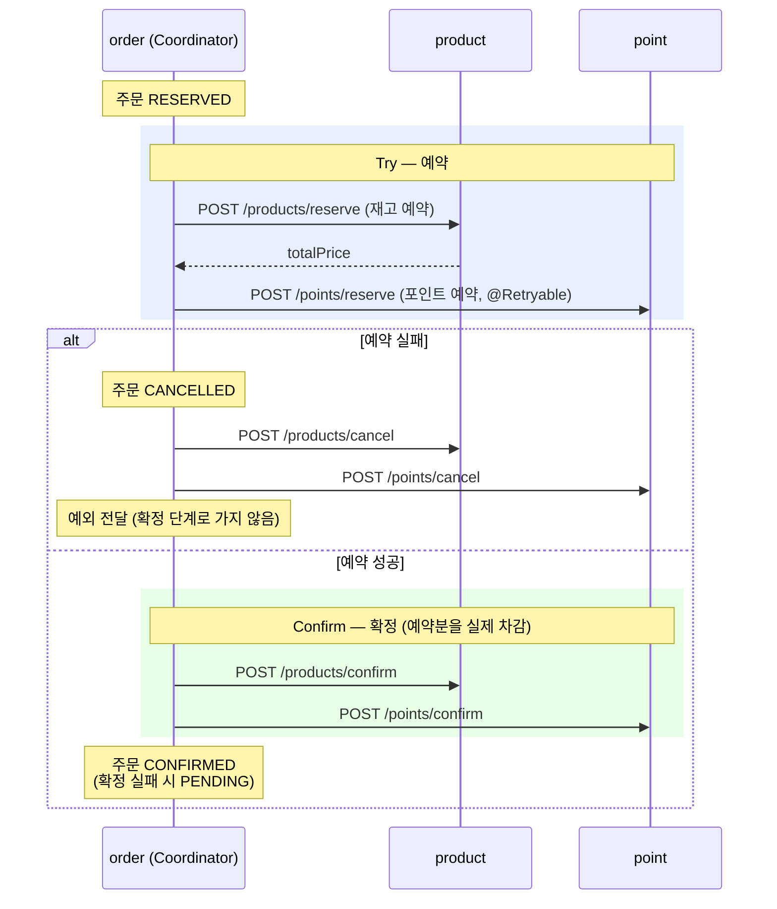
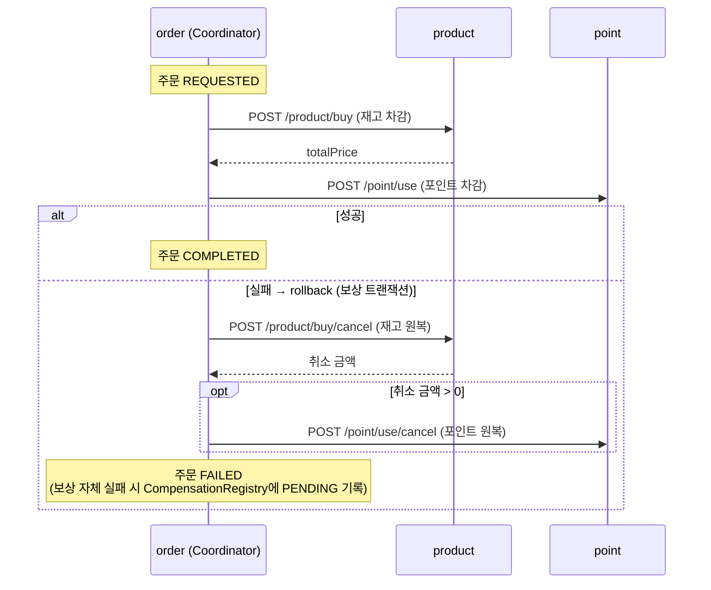
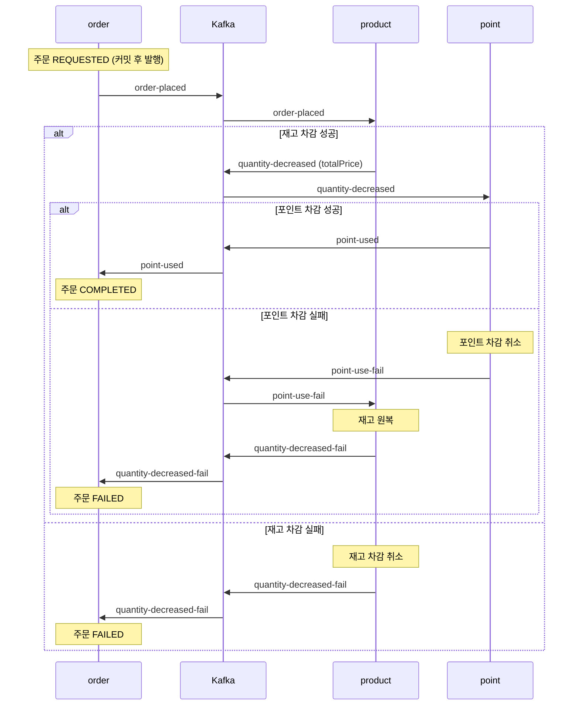

# 주문 시스템으로 알아보는 분산 트랜잭션 — 최종 정리

주문·재고·포인트를 처리하는 주문 시스템을 order·product·point 서비스로 나누고,
여러 서비스에 걸친 작업의 정합성을 맞추는 분산 트랜잭션 패턴 **TCC → SAGA Orchestration → SAGA Choreography**를 차례로 구현했다.

이 브랜치(`saga-choreography`)는 마지막 단계인 **SAGA Choreography** 구현이다. 이 문서에서 세 패턴을 최종 정리한다.

- 프로젝트 목적·요구사항·기술 스펙·모듈 구조·실행 방법은 [프로젝트 설명](docs/project.md)에 정리했다.
- 패턴 개념(TCC, SAGA, Choreography vs Orchestration, 실무에서의 선택)은 [분산 트랜잭션 패턴 정리](docs/concepts.md)에 있다.
- 날짜별 진행 내용은 [학습 기록](docs/study-log.md)에 있다.

## 브랜치 구성

모놀리식 주문 시스템(`monolithic` 모듈)과 MSA 토대(order·product·point 모듈 분리)는 모든 브랜치에 포함되어 있다.
별도로 두었던 `main` 브랜치는 삭제했고, 이 브랜치를 기본 브랜치로 사용한다.

| 브랜치 | 패턴 | 흐름 제어 | 통신 |
|---|---|---|---|
| [`tcc`](../../tree/tcc) | TCC (Try-Confirm-Cancel) | order의 코디네이터 (중앙 제어) | 동기 HTTP |
| [`saga-orchestration`](../../tree/saga-orchestration) | SAGA — Orchestration | order의 오케스트레이터 (중앙 제어) | 동기 HTTP |
| **`saga-choreography`** (이 브랜치, 기본 브랜치) | SAGA — Choreography | 각 서비스가 이벤트를 발행·구독 (분산 제어) | 비동기 메시지 (Kafka) |

## 3가지 패턴 요약

### TCC
- 트랜잭션을 **Try·Confirm·Cancel** 세 단계로 나누어 관리한다.
- 리소스를 먼저 **예약**한 뒤 확정을 짓는 방식으로 동작한다.
- **결제처럼 강한 정합성이 필요한 영역**에서 쓰이며, 일반적인 서비스에서는 사용 빈도가 낮은 편이다.

### SAGA
- 각 작업을 **개별 트랜잭션**으로 나누어 처리하고, 실패하면 **보상 트랜잭션**을 발행해 정합성을 맞춘다.
- TCC와 달리 리소스를 예약하지 않고 **즉시 차감**하며, **최종적 일관성(eventual consistency)** 을 보장한다.

#### Orchestration
- **코디네이터**가 각 참여자를 순차적으로 호출하면서 전체 트랜잭션의 흐름을 제어한다.
- 코디네이터가 있어 **흐름 파악이 쉽다**는 장점이 있어 **실무에서 많이 사용**된다.

#### Choreography
- 코디네이터 없이 각 서비스가 **이벤트를 발행·구독**하며 트랜잭션의 흐름을 이어 간다.
- **흐름 파악이 어렵다**는 단점이 있다.
- **로직의 처리 시간이 길어질 수 있는 상황**에서 많이 사용된다.

## 패턴별 주문 처리 흐름 비교

세 브랜치 모두 같은 시나리오(주문 생성 `POST /order` → 주문 처리 `POST /order/place`)를 다른 방식으로 처리한다.
주문 처리 요청은 order의 Redis 락으로 같은 주문의 동시 처리를 막은 뒤 시작한다.

| 구분 | TCC | SAGA Orchestration | SAGA Choreography |
|---|---|---|---|
| 흐름 제어 | order의 `OrderCoordinator` | order의 `OrderCoordinator` | 각 서비스가 이벤트를 구독해 다음 단계 진행 |
| 통신 | 동기 HTTP (RestClient) | 동기 HTTP (RestClient) | 비동기 메시지 (Kafka) |
| 참여자 작업 | 예약(Try) → 확정(Confirm) / 취소(Cancel) | 즉시 차감 → 실패 시 보상(취소) | 즉시 차감 → 실패 이벤트로 보상(취소) |
| `/order/place` 응답 시점 | 확정까지 끝난 뒤 | 차감(또는 보상)까지 끝난 뒤 | 이벤트 발행 직후 (결과는 `GET /order/{id}/status`로 조회) |
| 주문 상태 | `CREATED → RESERVED → CONFIRMED` (실패 `CANCELLED`, 확정 실패 `PENDING`) | `CREATED → REQUESTED → COMPLETED` (실패 `FAILED`) | `CREATED → REQUESTED → COMPLETED` (실패 `FAILED`) |

### TCC ([`tcc`](../../tree/tcc))



### SAGA Orchestration ([`saga-orchestration`](../../tree/saga-orchestration))



### SAGA Choreography (`saga-choreography`, 이 브랜치)



## 이 브랜치의 Choreography 구현

오케스트레이터 없이 order·product·point가 Kafka 토픽으로 이벤트를 주고받으며 다음 단계를 이어 간다.
각 서비스는 **자기 일을 하고, 결과를 이벤트로 알리기만** 한다. 실패하면 자기 작업을 보상(취소)하고 실패 이벤트를 발행한다.

### 이벤트(토픽)

| 토픽 | 발행 | 구독 | 구독 측 처리 |
|---|---|---|---|
| `order-placed` | order (`OrderPlaceProducer`) | product (`OrderPlacedConsumer`) | 재고 차감 → 성공 시 `quantity-decreased`, 실패 시 재고 차감 취소 후 `quantity-decreased-fail` |
| `quantity-decreased` | product | point (`QuantityDecreasedConsumer`) | 포인트 차감(금액 = `totalPrice`) → 성공 시 `point-used`, 실패 시 포인트 차감 취소 후 `point-use-fail` |
| `point-used` | point | order (`PointUsedConsumer`) | 주문 `COMPLETED` |
| `point-use-fail` | point | product (`PointUseFailConsumer`) | 재고 원복 후 `quantity-decreased-fail` |
| `quantity-decreased-fail` | product | order (`QuantityDecreasedFailConsumer`) | 주문 `FAILED` |

- 모든 이벤트의 키는 `orderId`이고, 참여자는 `orderId`를 `requestId`로 써서 이력 테이블로 중복 차감·중복 취소를 막는다.

### 구현 포인트

- **커밋 후 발행:** order는 주문을 `REQUESTED`로 바꾸는 트랜잭션이 커밋된 뒤(`TransactionSynchronization.afterCommit`) `order-placed`를 발행한다.
  커밋 전에 발행하면 DB 롤백 시 이미 나간 이벤트를 되돌릴 수 없다.
- **비동기 응답:** `POST /order/place`는 이벤트 발행 직후 응답한다. 최종 결과는 `GET /order/{id}/status`로 조회한다.
- **실패는 이벤트로 넘기고 예외는 다시 던지지 않는다:** consumer가 보상·실패 이벤트 발행 후 예외를 다시 던지면,
  Kafka 기본 에러 핸들러(`DefaultErrorHandler`)가 같은 메시지를 최대 10번 다시 처리해 실패 이벤트가 중복 발행된다.
- **역직렬화 타입:** consumer는 메시지를 문자열(`StringDeserializer`)로 받고, `KafkaConfig`의 `JsonMessageConverter`가 `@KafkaListener` 메서드의 파라미터 타입으로 JSON을 변환한다.
  서비스마다 이벤트 클래스 패키지가 달라도 필드 이름만 맞으면 되고, 받을 타입을 문자열로 적지 않아 오타·클래스 이동에 안전하다.
- **중복 주문 방지:** `POST /order/place`는 Redis 락 `order:choreography:{orderId}`로 같은 주문의 동시 처리를 막고, `Order.request()`(`CREATED`에서만 가능)로 재처리를 막는다.

### 실패 상황 테스트

`PointService.use` 끝의 `throw new RuntimeException("강제로 예외 발생")` 주석을 풀고 재기동한 뒤 주문을 처리한다.

- 기대 흐름: `point-use-fail` → product 재고 원복 → `quantity-decreased-fail` → 주문 `FAILED`
- 확인: `GET /order/{id}/status` 가 `FAILED`, 재고 원복(`CANCEL` 이력), 실패 토픽에 주문당 이벤트 1건

### 실행

MySQL(3306)·Redis(6379)·Kafka(9092)를 띄운 뒤 세 서비스를 실행한다. 설정은 각 모듈의 `application.yaml`에 있다.

```bash
./gradlew :product:bootRun   # 8081
./gradlew :point:bootRun     # 8083
./gradlew :order:bootRun     # 8080

curl -X POST localhost:8080/order -H 'Content-Type: application/json' \
  -d '{"items":[{"productId":1,"quantity":1},{"productId":2,"quantity":1}]}'   # → {"orderId":1}
curl -X POST localhost:8080/order/place -H 'Content-Type: application/json' -d '{"orderId":1}'
curl localhost:8080/order/1/status                                              # → "COMPLETED"
```

## 패턴별 정리

| 구분 | TCC | SAGA Orchestration | SAGA Choreography |
|---|---|---|---|
| 정합성 | 예약으로 자원을 미리 확보 → 중간 상태가 다른 요청에 노출되지 않음 | 즉시 차감 → 보상 전까지 일시적 불일치 | 즉시 차감 → 보상 전까지 일시적 불일치 |
| 참여자 구현 부담 | 큼 (Try·Confirm·Cancel 3개 API, 예약 테이블) | 중간 (실행·보상 2개 API, 이력 테이블) | 중간 (실행·보상 + 이벤트 발행·구독) |
| 흐름 파악 | 코디네이터 한 곳에서 보임 | 오케스트레이터 한 곳에서 보임 | 여러 서비스에 흩어져 있어 추적이 어려움 |
| 결합도 | order가 참여자 API를 모두 앎 | order가 참여자 API를 모두 앎 | 서비스는 토픽만 앎 (느슨한 결합) |
| 장애 영향 | 참여자 장애 시 동기 호출 실패 → 취소 / `PENDING` | 참여자 장애 시 동기 호출 실패 → 보상 / 보상 실패 기록 | 메시지가 브로커에 남아 있어 참여자가 복구되면 이어서 처리 |
| 이 저장소에서 남은 과제 | `PENDING` 주문 복구 | `CompensationRegistry` 재처리 스케줄러 | 중복 이벤트에 대한 order 상태 멱등 처리, DLT(실패 메시지 별도 토픽) |
