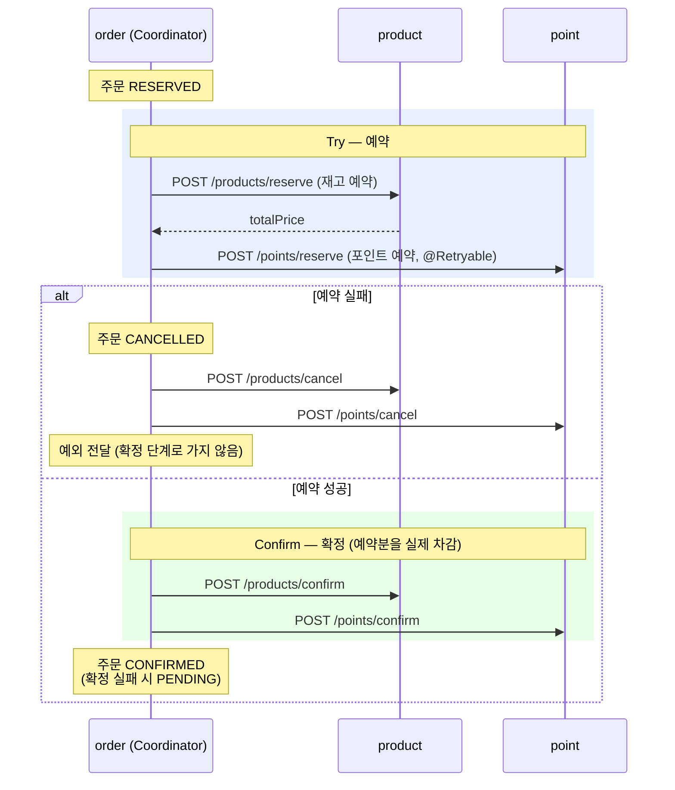

# 주문 시스템으로 알아보는 분산 트랜잭션 — TCC

주문·재고·포인트를 처리하는 주문 시스템을 order·product·point 서비스로 나누고,
여러 서비스에 걸친 작업의 정합성을 맞추는 분산 트랜잭션 패턴을 차례로 구현한다.

이 브랜치(`tcc`)는 첫 번째 패턴인 **TCC (Try-Confirm-Cancel)** 구현이다.

- 프로젝트 목적·요구사항·기술 스펙·모듈 구조·실행 방법·구현 상세는 [프로젝트 설명](docs/project.md)에 정리했다.
- TCC·SAGA Orchestration·SAGA Choreography의 최종 비교는 [`saga-choreography`](../../tree/saga-choreography) 브랜치에 있다.

## TCC란

- 트랜잭션을 **Try·Confirm·Cancel** 세 단계로 나누어 관리한다.
  - **Try:** 필요한 리소스를 **예약**만 한다. (실제로 차감하지 않음)
  - **Confirm:** 모든 예약이 성공하면 예약분을 **확정**(실제 차감)한다.
  - **Cancel:** 하나라도 예약에 실패하면 예약을 **취소**해 원래대로 돌린다.
- 예약으로 자원을 미리 확보하므로 중간 상태가 다른 요청에 노출되지 않아 **강한 정합성**을 얻을 수 있다.
- 대신 참여자마다 Try·Confirm·Cancel 3개 API와 예약 데이터를 따로 구현해야 해서 부담이 크다.
- **결제처럼 강한 정합성이 필요한 영역**에서 쓰이며, 일반적인 서비스에서는 사용 빈도가 낮은 편이다.

## 이 브랜치의 TCC 구현

order가 **코디네이터**(`OrderCoordinator`)가 되어 product·point를 동기 HTTP(RestClient)로 차례로 호출한다.
주문 생성(`POST /order`)과 주문 처리(`POST /order/place`)를 나누고, 주문 처리에서 Try → Confirm을 진행한다.



```
POST /order/place (OrderController)
└── Redis 락 order:place:{orderId} 획득 (실패 시 거절)
    └── OrderCoordinator.placeOrder
        ├── reserve (Try)
        │   ├── 주문 CREATED → RESERVED
        │   ├── product 재고 예약   → totalPrice 응답
        │   ├── point 포인트 예약   (금액 = totalPrice, 사용자 1번)
        │   └── 실패 시: 주문 CANCELLED → product·point 취소를 각각 시도 → 예외 전달
        └── confirm (Confirm)
            ├── product 예약 확정
            ├── point 예약 확정
            ├── 성공 시: 주문 RESERVED → CONFIRMED
            └── 실패 시: 주문 RESERVED → PENDING (예외는 전달하지 않음)
└── 락 해제 (finally)
```

### 주문 상태

| 상태 | 전이 | 의미 |
|---|---|---|
| `CREATED` | 주문 생성 시 | 주문만 저장된 상태 |
| `RESERVED` | `CREATED` → | Try 시작. product·point 예약 진행 중 |
| `CANCELLED` | `RESERVED` → | 예약 실패. 참여자 예약 취소 |
| `CONFIRMED` | `RESERVED` → | 확정까지 성공 |
| `PENDING` | `RESERVED` → | 예약은 성공했지만 확정 중 실패. 나중에 확정을 다시 시도해야 하는 상태 |

- 상태 변경은 `Order`의 메서드(`reserve`·`cancel`·`confirm`·`pending`)에서 이전 상태를 검사한다.
  그래서 이미 처리된 주문(`CREATED`가 아님)으로 `/order/place`를 다시 호출하면 예약 단계에서 거절된다.

### 참여자 (product·point)

참여자는 실제 값(`quantity`·`amount`)과 별도로 **예약 값**(`reservedQuantity`·`reservedAmount`)을 두고,
요청마다 예약 내역을 예약 테이블에 저장한다. 같은 `requestId`로 Try·Confirm·Cancel을 호출한다.

| 단계 | product (`/products/*`) | point (`/points/*`) |
|---|---|---|
| Try (`reserve`) | 예약 가능 수량(`quantity - reservedQuantity`) 확인 → `reservedQuantity` 증가, `product_reservations`에 `RESERVED` 저장, 총 금액 응답 | 예약 가능 금액(`amount - reservedAmount`) 확인 → `reservedAmount` 증가, `point_reservations`에 `RESERVED` 저장 |
| Confirm (`confirm`) | `quantity`·`reservedQuantity`를 예약 수량만큼 차감, 예약 `CONFIRMED` | `amount`·`reservedAmount`를 예약 금액만큼 차감, 예약 `CONFIRMED` |
| Cancel (`cancel`) | `reservedQuantity`만 되돌림 (재고는 그대로), 예약 `CANCELED` | `reservedAmount`만 되돌림 (포인트는 그대로), 예약 `CANCELLED` |

### 구현 포인트

- **락은 트랜잭션 바깥에서 잡고 푼다:** 참여자는 `LockTransactionExecutor`(common)로 Redis 락 획득 → `TransactionTemplate`으로 트랜잭션 실행(커밋) → 락 해제 순서로 처리한다.
  `@Transactional` 메서드 안에서 락을 풀면 커밋 전에 락이 풀려, 다른 요청이 커밋 전 상태를 읽고 중복 처리할 수 있다.
- **동시성 실패만 재시도한다:** 참여자의 Facade 서비스(`ProductFacadeService`·`PointFacadeService`)는 `RetryExecutor`(common)로 감싼다.
  락 획득 실패·낙관적 락 충돌(`ConcurrencyFailureException` 계열)만 1초 간격으로 최대 3회 시도하고, 수량 부족 등은 바로 던진다.
- **공통 모듈 분리:** `RedisLockService`·`LockTransactionExecutor`·`RetryExecutor`는 product·point가 같은 방식으로 쓰므로 `common` 모듈로 뺐다.
- **포인트 예약 재시도 (Spring Retry):** `PointApiClient.reserve`에 `@Retryable`(최대 3회, 500ms 간격)을 붙여 일시적인 오류(타임아웃 등)에 대처한다.
  400·404(`noRetryFor`)는 다시 보내도 결과가 같으므로 재시도하지 않도록 지정했다. 같은 `requestId`로 다시 보내므로 point는 중복 예약하지 않는다.
  다만 참여자에 예외 처리기(`@ControllerAdvice`)가 없어 포인트 부족 같은 업무 오류도 500으로 응답하므로, 실제로는 이런 오류도 3회 시도된다.
- **읽기 타임아웃 2초:** `ApiClientConfig`에서 RestClient에 읽기 타임아웃을 둔다. 참여자가 응답하지 않을 때 무한정 기다리지 않고 실패(→ 재시도·취소)로 넘어간다.
- **주문별 `requestId`(UUID):** 주문 생성 시 UUID를 한 번 만들고, 예약·확정·취소에 같은 값을 보내 참여자가 중복 요청을 걸러낸다.
  주문 ID는 DB가 초기화되면 1부터 다시 시작해 다른 주문과 겹칠 수 있어 UUID를 쓰고, DB에서 바로 읽을 수 있도록 `CHAR(36)`으로 저장한다.
- **예약 실패 → 양쪽 모두 취소 (각각 처리):** 예약이 어디까지 진행됐는지 알 수 없어 product·point 모두 취소를 시도한다.
  예약되지 않은 쪽은 취소 시 예외가 나므로, 한쪽 취소 실패가 다른 쪽 취소를 막지 않도록 `try`를 따로 둔다. 그 뒤 예외를 다시 던져 확정 단계로 가지 않는다.
- **확정 실패 → `PENDING`:** 예약은 이미 성공했으므로 취소하지 않고 `PENDING`으로 남겨, 나중에 확정을 다시 시도할 수 있게 한다.

### 남은 과제

- **`PENDING` 주문 복구 미구현:** `PENDING` 주문을 찾아 확정을 다시 시도하는 로직(스케줄러 등)이 없다.
  또 `Order.confirm()`은 `RESERVED`에서만 허용하므로, 복구를 만들려면 `PENDING`에서도 확정할 수 있게 바꿔야 한다.
- **재시도 실습용 코드가 남아 있다:** `PointController.reserve`는 기동 후 첫 요청에서 2초 대기한다(`count` 변수).
  order의 읽기 타임아웃(2초)을 일부러 넘겨 `@Retryable` 재시도를 확인하기 위한 코드다.
- **포인트 사용자 고정:** 포인트 예약 시 사용자 ID를 `1L`로 고정해 보낸다.
